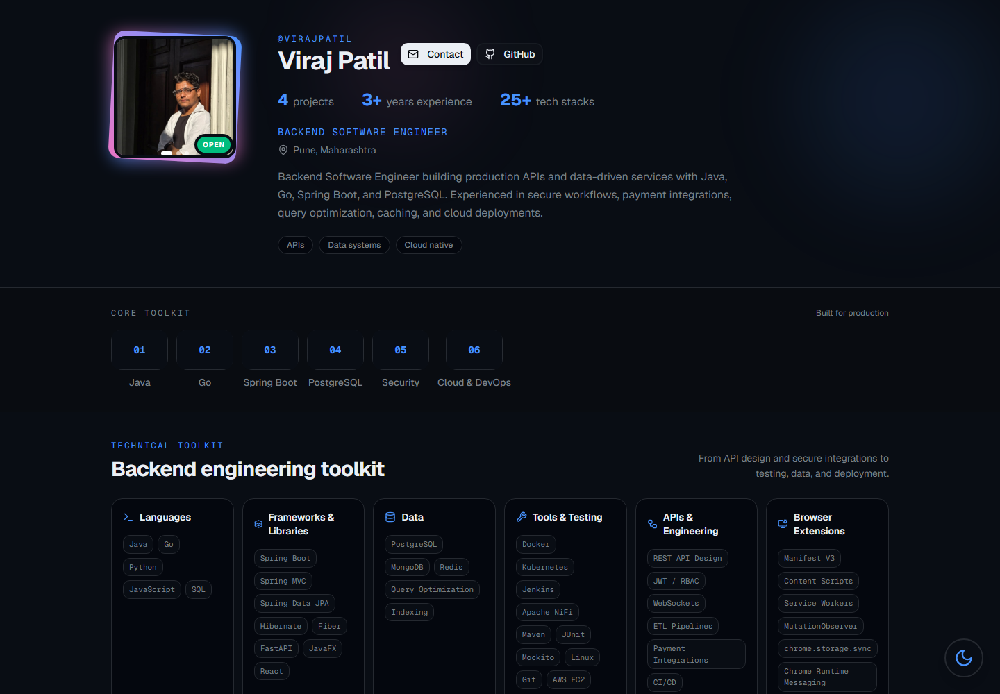

# InstaPortfolio

An Instagram-inspired developer portfolio that presents a profile, technical toolkit, work experience, education, and projects as an interactive social feed. InstaPortfolio is built with Next.js, React, and TypeScript, and is customized with a single resume-data file.

[](https://virajpatil.vercel.app)
[](https://nextjs.org/)
[](https://react.dev/)
[](https://www.typescriptlang.org/)

## Preview

The following screenshot is captured from the running application:



## Features

- Instagram-inspired profile, highlights, and project feed
- Responsive layouts for mobile, tablet, and desktop
- Profile photo gallery, category filters, and project detail views
- Light and dark themes
- Contact details and social profile links
- Resume content maintained in one data file

## Technology

- Next.js 16 App Router
- React 19 and TypeScript
- Tailwind CSS 4
- Radix UI primitives and Lucide icons
- Vercel Analytics

## Getting started

### Requirements

- Node.js 20.9 or later
- npm

### Install and run

```bash
git clone https://github.com/vrajjptl/instaportfolio.git
cd instaportfolio
npm install
npm run dev
```

Open [http://localhost:3000](http://localhost:3000). The development server supports hot reloading.

### Production build

```bash
npm run build
npm run start
```

The production server is available at [http://localhost:3000](http://localhost:3000).

## Customize your portfolio

1. Update `lib/resume-data.ts` with your profile, contact details, highlights, skills, projects, experience, and education.
2. Put your profile photos in `public/images/` and update `profile.avatar` and `profile.gallery` to use their `/images/...` paths.
3. Add a real public project URL in a project's `liveUrl` field when one is available. Leave the field out for projects without a public demo.
4. Update the page title and description in `app/layout.tsx`.

The feed, profile, skills, and contact UI read from the resume data, so you do not need to edit individual components for routine content changes.

## Project structure

```text
app/
  layout.tsx          Page metadata and root layout
  page.tsx            Portfolio page composition
  globals.css         Theme tokens and global styles
components/           Portfolio UI and reusable UI primitives
lib/
  resume-data.ts      Profile and portfolio content
  utils.ts            Shared utilities
public/
  images/             Profile images
  ...                 Icons and portfolio screenshot
```

## Deploy on Vercel

1. Import `vrajjptl/instaportfolio` in [Vercel](https://vercel.com/new).
2. Keep the detected Next.js framework settings.
3. Deploy. Vercel uses `npm run build` by default; no environment variables are required by the current app.

The published portfolio is available at [virajpatil.vercel.app](https://virajpatil.vercel.app).

## Roadmap

- Add public repository or demo links to projects when they are available.
- Add keyboard-focused interaction and automated accessibility checks.
- Add a lightweight continuous-integration check for builds and linting.

## Contributing

Bug reports, ideas, and pull requests are welcome. Please read [CONTRIBUTING.md](./CONTRIBUTING.md) and use the provided issue and pull request templates.

## License

This repository does not currently include a license. Please do not assume permission to reuse, modify, or redistribute the project until the maintainer selects one.
